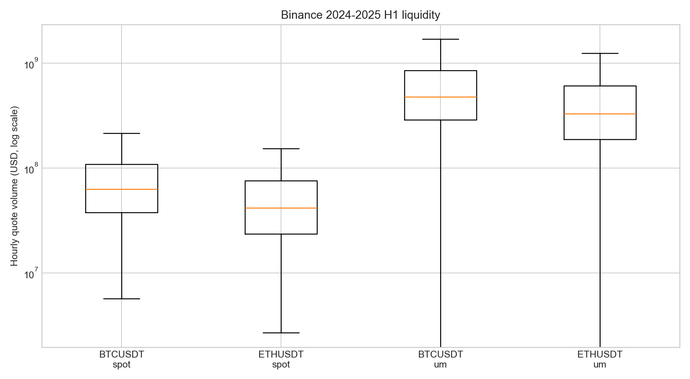
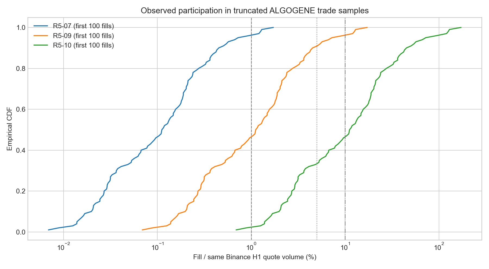
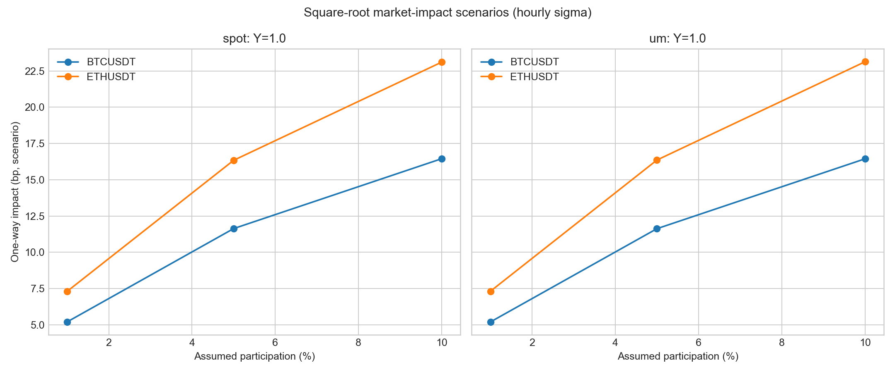
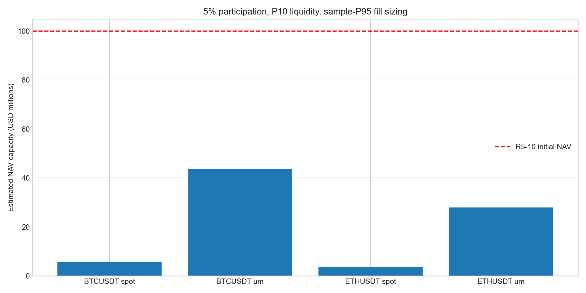

# R5-11—R5-14 Binance 流动性、市场冲击与资金容量

## 结论

本轮按 Binance Public Data 路线完成，不修改策略，不新增 ALGOGENE 回测。真实市场输入为 2024-01-01 至 2025-12-31 的 BTCUSDT、ETHUSDT 现货及 USD-M 永续 1 小时 K 线；96 个 Binance 月度 ZIP 均与发布方 SHA-256 一致，四个市场各 17,544 小时，共 70,176 行。

R5-07/R5-09/R5-10 的完整汇总均为 1,694 fills、423 个已完成配对。逐笔接口却只返回最早 100 fills（2024-01-18 至 2024-02-23），因此本文严格拆成：

- 完整记录：成交数、已完成配对、累计成交名义额、年末快照 NAV、资金占用和 BTC/ETH 完成配对汇总。
- 截断样本：逐笔成交规模、成交时点与 Binance 同小时成交额的匹配、参与率分布。不能把前 100 笔当成全样本分位数。

容量结论只能表述为情景：在单腿约为当时 NAV 20%、以现货 ETH 为瓶颈时，P10 小时成交额口径下，1%/5%/10% 参与率对应约 **0.76/3.79/7.58 百万美元 NAV**；以截断样本 P95 单腿比例复算约为 **0.71/3.57/7.14 百万美元**。中位小时口径下对应约 **2.08/10.41/20.83 百万美元**。这不是“真实容量上限”，也不是成交保证。

## R5-11 历史市场数据收集

| 市场 | 小时数 | 两年成交额 USDT | P10 小时成交额 | 中位小时成交额 | P90 小时成交额 | H1 对数收益波动率 |
|---|---:|---:|---:|---:|---:|---:|
| BTCUSDT 现货 | 17,544 | 1.617 万亿 | 2,455.98 万 | 6,290.56 万 | 1.912 亿 | 0.5204% |
| BTCUSDT USD-M | 17,544 | 12.634 万亿 | 1.868 亿 | 4.774 亿 | 15.310 亿 | 0.5201% |
| ETHUSDT 现货 | 17,544 | 1.094 万亿 | 1,515.08 万 | 4,165.24 万 | 1.298 亿 | 0.7309% |
| ETHUSDT USD-M | 17,544 | 8.837 万亿 | 1.197 亿 | 3.300 亿 | 10.640 亿 | 0.7317% |

USDT 成交额按 USD 名义额代理处理；没有假定 USDT/USD 永远严格等于 1。数据清单逐文件保留 URL、文件大小、发布方 SHA-256、本地 SHA-256、行数和首末时间，见 [r5_11_data_manifest.csv](r5_11_14/r5_11_data_manifest.csv)。



## P80 原始回测完整度

| 实验 | 初始 NAV | 完整 fills | 完成配对 | 完整成交名义额 | 年末快照 NAV | native financing | 峰值 reserved gross/NAV |
|---|---:|---:|---:|---:|---:|---:|---:|
| R5-07 | $1.0m | 1,694 | 423 | $692.03m | $3.661m | $3,524 | 81.472% |
| R5-09 | $10m | 1,694 | 423 | $6.920bn | $36.611m | $35,244 | 81.473% |
| R5-10 | $100m | 1,694 | 423 | $69.204bn | $366.113m | $352,439 | 81.473% |

来源为成功的 [R5-07 run 45532185601](https://github.com/ketianli082-stack/new-algo/actions/runs/45532185601) 和 [R5-09/R5-10 run 45540482631](https://github.com/ketianli082-stack/new-algo/actions/runs/45540482631)。artifact 原始 `platform-responses.json` 与 `trade_statistics.json` 已保存在 `r5_11_14/source/`。峰值超过 80% 是观测快照值，入场上限不保证价格变化后持续不越界。

## R5-12 成交量参与率

参与率定义为 `ALGOGENE 单腿成交名义额 / Binance 同品种同市场同小时 quote volume`。逐笔记录只有每组最早 100 fills；汇总如下：

| 实验 | 100 笔合并中位 | P95 | 最大 | >1% | >5% | >10% |
|---|---:|---:|---:|---:|---:|---:|
| R5-07 | 0.114% | 0.735% | 1.720% | 4% | 0% | 0% |
| R5-09 | 1.139% | 7.349% | 17.198% | 54% | 10% | 4% |
| R5-10 | 11.386% | 73.494% | 171.985% | 98% | 67% | 54% |

分市场看，R5-09 的 ETH 现货中位参与率 4.058%、P95 12.885%、最大 17.198%；R5-10 的 ETH 现货中位 40.581%、P95 128.851%、最大 171.985%。超过 100% 表示该模拟成交名义额大于 Binance 该小时全部 ETHUSDT 现货成交额，证明 ALGOGENE 规模线性放大没有受到真实交易所容量约束；不能解释为可真实成交。



逐市场汇总见 [r5_12_participation_summary.csv](r5_11_14/r5_12_participation_summary.csv)，100 笔逐行匹配见 [r5_12_trade_sample_matched.csv](r5_11_14/r5_12_trade_sample_matched.csv)。

## R5-13 市场冲击成本

采用明确的平方根冲击情景：

`单边冲击 bp = Y × H1 对数收益标准差 × sqrt(参与率) × 10,000`

Y 取 0.5/1.0/1.5，参与率取 1%/5%/10%。这是用户指定的参数化假设，不是本回测观测到的真实滑点。

| 品种 | 参与率 | Y=0.5 | Y=1.0 | Y=1.5 |
|---|---:|---:|---:|---:|
| BTC（现货/永续近似相同） | 1% | 2.60 bp | 5.20 bp | 7.81 bp |
| BTC | 5% | 5.82 bp | 11.63 bp | 17.45 bp |
| BTC | 10% | 8.23 bp | 16.45 bp | 24.68 bp |
| ETH（现货/永续近似相同） | 1% | 3.65 bp | 7.31 bp | 10.97 bp |
| ETH | 5% | 8.17 bp | 16.35 bp | 24.52 bp |
| ETH | 10% | 11.56 bp | 23.12 bp | 34.67 bp |



若把每一组假设冲击机械应用到 R5-07 的完整已完成成交名义额，Y=1 时，1%/5%/10% 情景冲击成本约为 **$0.432m/$0.966m/$1.366m**，分别为初始 NAV 的 **43.21%/96.62%/136.64%**。该计算保持历史成交路径不变，没有模拟冲击反馈、拆单、盘口恢复、订单拒绝或 NAV 复利变化，因此只能用于说明原回测固定 1 bp 滑点可能严重低估大规模换手成本，不能当作净回测结果。

完整网格见 [r5_13_impact_scenarios.csv](r5_11_14/r5_13_impact_scenarios.csv) 和 [r5_13_impact_cost_scenarios.csv](r5_11_14/r5_13_impact_cost_scenarios.csv)。

## R5-14 资金容量估计

以每腿约 20% 当时 NAV 的策略目标规模换算，容量由现货 ETH 决定：

| Binance 小时流动性口径 | 1% 参与率 | 5% 参与率 | 10% 参与率 |
|---|---:|---:|---:|
| P10 小时、20% 单腿 | $0.76m | $3.79m | $7.58m |
| P10 小时、截断样本 P95 单腿 | $0.71m | $3.57m | $7.14m |
| 中位小时、20% 单腿 | $2.08m | $10.41m | $20.83m |
| 中位小时、截断样本 P95 单腿 | $1.96m | $9.81m | $19.62m |

因此：

- R5-07 的 $1m 初始资金在前 100 笔样本中整体未触及 5%，但 ETH 现货最大已达 1.72%；不能据此证明全期均可执行。
- R5-09 的 $10m 仅接近“中位小时、5%”边界；在 P10 小时明显超出，且实际截断样本已有 10% 的 fills 超过 5%、4% 超过 10%。
- R5-10 的 $100m 远超所有列示情景，前 100 笔已有 54% 超过 10%，不具备按 Binance 同小时成交额直接执行的证据。



该容量表不是“真实容量上限”。实际可执行资金还取决于订单簿深度、盘口恢复、拆单周期、maker/taker 比例、跨市场可用性、价差相关性、波动状态、延迟、拒单与部分成交。若要给出可交易容量，需要 L2/order-book replay 或小额实盘冲击实验；本轮没有这些数据，也没有伪称已验证。

## 可复现方式

脚本：[tools/r5_11_14_binance_capacity.py](../../tools/r5_11_14_binance_capacity.py)。首次运行下载并校验 Binance 数据，之后可离线复算：

```bash
python -u tools/r5_11_14_binance_capacity.py --workers 8
python -u tools/r5_11_14_binance_capacity.py --skip-download
```

单元测试：[tests/test_r5_11_14_binance_capacity.py](../../tests/test_r5_11_14_binance_capacity.py)。全部数值表、图和生成元数据位于 `results/phase_b/r5_11_14/`。
